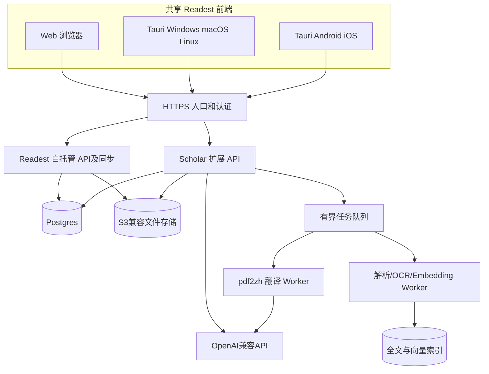

# Readest Scholar：面向自主开发 Agent 的完整工程实施方案

> 版本：1.0｜编写日期：2026-10-19｜状态：工程规划/待 Agent 审计验证<br>
> 基础项目：[Readest](https://github.com/readest/readest)｜翻译引擎：[PDFMathTranslate-next](https://github.com/PDFMathTranslate/PDFMathTranslate-next)<br>
> 本文是**任务规格和执行手册**，不是已经完成的实现。任何涉及当前源码、第三方许可证、运行环境的推断必须由 Agent 在实施时重新核对并留下证据。

## 0. 给 Agent 的最高优先级指令（可直接作为总任务）

你是本项目的主工程 Agent，负责需求细化、架构审计、代码开发、测试、文档、打包、持续集成和发布准备。项目目标是基于 Readest 官方代码开发 **Readest Scholar**：一套可在 Linux 服务器 Docker 自托管、通过浏览器阅读、在 macOS/Windows/Linux/Android/iOS 运行并自动同步书籍、阅读进度、PDF 批注和科研笔记的文献阅读系统；提供 Zotero 风格文献管理、OpenAI 兼容 AI 侧边栏和 pdf2zh 保排版翻译。

**执行原则：**
1. 先审计再设计，先测试再改代码，先 staging 验证再发布。不得臆造仓库路径、接口、已实现的功能或测试结果。
2. 尽量在 Readest 官方仓库上小幅、可维护地扩展；以 `AppService` 和既有平台适配层为基础。避免重写阅读核心、同步和现有 AI 系统。
3. 每个任务都提交需求依据、方案、代码、测试、文档、风险、验收证据。修改需可撤回，并记录上游差异。
4. 在没有明确授权前，不购买服务、不暴露端口到公网、不发布应用商店、不修改生产数据、不推送正式 release、不使用真实用户数据进行测试。若发布权限和签名凭据齐备，也必须使用受保护环境的人工审批闸门。
5. 不要把 LLM 生成的代码视为已验证；自动化测试、跨平台实测及安全检查是硬性阻断条件。
6. 阻塞时保留可运行的最小成果，记录失败原因、重现步骤和下一条动作；不得掩盖失败、绕过失败测试或降低验收标准。
7. 所有实现以锁定的上游 Git commit 和依赖锁文件为准；本规格中的路径、版本与许可证均需按 checkout 的实际源码校验。

## 1. 目标、边界与非目标

### 1.1 产品定位

- 以 PDF 研究文献为核心，兼顾 EPUB/MOBI/TXT 等原有 Readest 阅读能力。
- 私有化优先：书籍、元数据、阅读位置、批注、笔记、派生译文、AI 会话可以由用户保存在自己的服务器。
- 同一账户可从桌面、移动端和 Web 使用；客户端按需缓存和离线使用，恢复联网后增量同步。
- 学术工作流：导入论文 → 识别元数据 → 分类/检索 → 阅读/批注 → 划词翻译/整篇翻译 → AI 解释与引用 → 导出笔记。
- 保留外部协作能力：BibTeX/RIS 导入导出、Zotero 交换、PDF 标准批注导出。

### 1.2 平台验收矩阵

| 平台 | 交付形态 | 最低要求 |
|---|---|---|
| Web | Docker 容器 + HTTPS | 登录、管理书库、PDF/EPUB 阅读、同步和 AI |
| macOS | Tauri 安装包 | arm64/x64 可安装、离线阅读与自动同步 |
| Windows | Tauri 安装程序 | x64 可安装、离线阅读与自动同步 |
| Linux | Tauri 安装包 | 选择明确支持的发行版与架构 |
| Android | APK/AAB | 阅读、同步、批注，后台行为符合系统限制 |
| iOS/iPadOS | 签名 IPA/TestFlight | 阅读、同步、批注，合法签名和分发 |

> 必须区分 **CI 成功构建** 与 **真实设备验证成功**。iOS 签名、公证和 TestFlight/应用商店发布依赖 Apple 凭据与人工审批；Android 发布也依赖签名/商店权限。

### 1.3 V1 必须交付（P0）

- 自托管用户认证与个人文献库；Docker Compose 快速启动与管理员初始化。
- 书籍导入、文件夹/集合、标签、搜索、基础作者/标题/年份/DOI 字段、去重（先文件哈希再元数据建议）。
- 保留 Readest 既有 PDF/EPUB 阅读、书签、阅读进度、基本批注；增强文献笔记侧栏与来源定位。
- 服务器与本地双向同步：书籍文件、元数据、阅读进度、批注、笔记、附件引用；支持离线变更和冲突恢复。
- AI 侧边栏：选中文本解释/翻译/摘要、针对当前 PDF 问答、参考页码与点击定位；支持自定义 OpenAI 兼容服务。
- pdf2zh Next 作为独立翻译 Worker：支持纯中文/双语派生 PDF、进度、失败重试、原文与译文并存。
- Web + macOS + Windows + Linux 可安装或可用；Android/iOS 至少完成构建与关键场景实测后再宣布支持。
- 自动化测试、可恢复备份、日志、CI/CD、上游依赖维护。

### 1.4 V1.1/P1 与 V2/P2

- P1：专业批注（矩形、箭头、自由绘制、PDF 标准批注导出）、多篇论文对比、OCR 可选队列、BibTeX/RIS 导出/导入、Zotero 文件/文献交换、术语表。
- P2：双向 Zotero 同步、OCR 多模态图表分析、知识图谱、结构化论文综述/思维导图、MCP 服务、协作、全文翻译映射到原文批注。
- **非目标**：像素级完美保排版、无冲突的任意第三方 PDF 编辑器双向同步、未经测试就承诺扫描 PDF 所有内容可问答、第一版全平台功能绝对一致。

## 2. 上游审计：第一阶段必须完成

### 2.1 固定来源与审计对象

- 官方 Readest：`https://github.com/readest/readest`
- 文档：`apps/readest-app/docs/architecture.md`、`code-layout.md`、`testing.md`、`AGENTS.md`、`DESIGN.md`
- 官方 Docker：`docker/README.md`、Compose 配置、`.env.example`
- pdf2zh Next：`https://github.com/PDFMathTranslate/PDFMathTranslate-next`
- 参考但不默认 Fork：`https://github.com/luoji12103/readest-self-hosted`

### 2.2 审计输出 `docs/audit/`

必须产出：
- `upstream-baseline.md`：SHA、tag、分支、依赖版本、构建环境、许可证及第三方组件清单。
- `architecture-inventory.md`：真实源码目录、平台适配、AI、PDF、EPUB、同步、书库、数据库、API、鉴权和 Docker 拓扑。
- `feature-gap-matrix.md`：逐项证明 **已有 / 可扩展 / 需新增 / 不适用**；链接到对应源码和测试。
- `data-flow-and-trust-boundaries.md`：文件、用户、模型 API、同步服务、翻译 Worker 的数据流与信任边界。
- `risk-register.md`：许可证、同步冲突、隐私、WebView 差异、PDF 批注格式、迁移及签名发布风险。
- `adr/0001-foundation.md`：是否沿用 Readest 现有同步（默认优先），是否真的需要新增 FastAPI 服务；**不得未经证据就把所有现有后端替换为 FastAPI**。

审计命令应首先读取仓库自己的 `AGENTS.md` 和脚本，使用官方建议的 `pnpm`、测试框架及工作树管理。只有实际可运行的命令才写入执行日志。

### 2.3 技术事实基线（实施时重查）

Readest 官方文档描述的主工程为 `apps/readest-app`，Next.js/React + Tauri 2，内含 `AppService` 的 Web/Native/Node 平台适配，既有 AI、书库、同步和测试模块。官方自托管栈包括 Readest Web、Supabase/Postgres 组件及对象存储。pdf2zh Next 支持 CLI/WebUI/Docker，使用 AGPLv3，**它不天然提供满足本项目稳定 SLA 的任务队列 API**，需要我们的适配层。

## 3. 推荐的目标系统架构



### 3.1 关键设计决定

1. **Readest 原有核心保持主导**：共享阅读 UI、格式解析、原有账户和文件同步。新增 Scholar 模块以扩展边界挂载，而非重写核心。
2. **新增功能分离**：文献目录、引用/元数据、AI 检索、翻译调度可独立封装；如果 Readest 的现有 API 足够扩展，则优先在其 Next.js 路由内实现，只有 PDF/OCR Python 计算要求时新增独立 Worker/API。
3. **服务端数据权威，客户端可离线**：文件以不可变对象/版本 ID 管理；客户端持有本地元数据副本、操作队列和文件缓存。
4. **原始 PDF 永不被自动覆盖**：译文、OCR 版、带批注导出文件均是有来源关系的派生附件。
5. **提供稳定接口与能力协商**：客户端、服务端、Worker 的新旧版本兼容；在功能不受支持时降级而非损坏数据。

### 3.2 扩展代码组织（示例，Agent 依据审计确定真实落点）

```text
readest-scholar/
  apps/readest-app/        # 以 Readest 上游实际结构为准
  packages/scholar-domain/ # 文献实体/类型/业务规则（若确有复用需求）
  packages/scholar-ui/     # 文献管理、笔记、AI 组件（若适合独立包）
  services/translator/     # pdf2zh Worker 的独立封装
  services/document-ai/    # 文本提取、引用和检索服务（可延后）
  infra/compose/          # Docker 及示例配置
  tests/fixtures/         # 合法可分发的 PDF/EPUB 样例
  docs/                  # ADR、接口、部署和测试证据
  .github/workflows/     # CI / 发布 / 上游同步
```

不要为追求模块化而提前增加十几个独立服务；每个新增服务要附成本、隔离必要性与降级机制说明。

## 4. 数据模型与版本化设计

以下是逻辑实体，不是直接可执行的数据库迁移；Agent 需先匹配 Readest 原始表结构，增量建表并避免破坏上游迁移。

| 实体 | 核心字段 | 约束 |
|---|---|---|
| `Document` | id, owner_id, title, authors[], DOI, year, type, created_at | 用户隔离、稳定 UUID |
| `DocumentFile` | id, document_id, sha256, storage_key, mime, size, kind, source_file_id | 原文/译文/导出版本；不可变对象 |
| `Collection` | id, owner_id, parent_id, name | 层级不得形成环 |
| `CollectionDocument` | collection_id, document_id | 多对多 |
| `Tag` / `DocumentTag` | owner_id, normalized_name, document_id | 同账户标签唯一 |
| `ReadingState` | user_id, file_id, position, updated_at, device_id | PDF page+offset, EPUB CFI；支持设备冲突 |
| `Annotation` | id, file_id, kind, anchor_json, body, color, revision, deleted_at | 几何位置与文本锚点双保存；软删除 |
| `ResearchNote` | id, document_id, markdown, source_anchor, revision | 笔记→原文跳转 |
| `SyncOperation` | op_id, user_id, device_id, entity_id, base_rev, payload, server_seq | 幂等操作、可重放 |
| `AIConversation` | id, document_id, provider_id, created_at | 会话属于用户，支持清理 |
| `CitationChunk` | id, file_id, page, bbox, text_hash, text, embedding_ref | 精确引用，安全过滤 |
| `TranslationJob` | id, file_id, mode, source_lang, target_lang, state, worker_version, result_file_id | 可取消、超时、重试 |
| `GlossaryEntry` | id, owner_id, source_term, target_term, domain | 用户术语偏好 |

### 4.1 同步协议要求

- **文件**：以 SHA-256 识别二进制、分块/断点续传、上传后验证哈希；服务端按版本 ID 记录，不覆盖老版本；可选择按需下载/整库镜像，限制移动网络下载。
- **元数据/批注/笔记**：客户端生成 UUID + `op_id`；服务器操作日志分配严格递增 `server_seq`，以 cursor 增量拉取；提交幂等。必须测试重复投递、乱序、断网、重试、删除墓碑。
- **冲突策略**：不同批注记录可合并；同一批注的并发编辑保留可恢复的冲突版本（不能静默覆盖）；收藏夹/标签集合用实体级变更；阅读位置默认采用最近显式阅读会话而非简单系统时间 LWW，提供设备位置选择/恢复。
- **批注坐标**：PDF 以 page index + 标准化页内坐标 + quadpoints + 可选文本锚点存储；EPUB 以 CFI/DOM 范围；屏幕缩放、旋转、裁边不会改变存储坐标。
- **导出**：用户执行“导出带批注 PDF”时映射为标准 PDF Annotation；没有等价标准的元素记录在导出报告内，不得假称全部可逆。第三方 PDF 改动需要显式导入对比，不默认为同一版本。
- **本地持久化**：先检查 Readest 现有 Turso/SQLite/浏览器存储模型；优先复用，避免并行维护互不一致的第二套数据库。
- **兼容性**：每个请求携带客户端 schema/protocol 版本和能力列表；服务端保留不少于一个受支持旧客户端版本的兼容窗口，具体政策写入发布文档。

### 4.2 最小接口契约（示例）

```http
GET  /api/scholar/v1/capabilities
GET  /api/scholar/v1/documents?cursor=...
POST /api/scholar/v1/documents
POST /api/scholar/v1/files/uploads
POST /api/scholar/v1/sync/push
GET  /api/scholar/v1/sync/pull?cursor=...
POST /api/scholar/v1/translation-jobs
GET  /api/scholar/v1/translation-jobs/{id}
POST /api/scholar/v1/ai/ask
GET  /api/scholar/v1/ai/conversations
```

所有接口必须用 OpenAPI 或等价可检查契约建模；实现身份鉴权、对象所有权、文件大小限额、分页、请求幂等、速率限制、审计日志、错误码。HTTP 状态和响应 JSON 规范通过契约测试覆盖。

## 5. 核心产品功能实现规范

### 5.1 文献管理（参考小绿鲸工作流、Zotero 数据模型）

- 桌面三栏：左侧集合/标签，中间文献列表/筛选，右侧元数据/预览；阅读页左侧目录/批注，中央 PDF，右侧切换 AI/笔记/翻译面板。
- 手机单栏，底部导航或侧抽屉，AI 面板独立页面或底部 Sheet。
- 支持 PDF/EPUB 拖入导入、批量导入、扫描本地目录（有权限时）、文件去重、缺失元数据人工编辑。
- DOI/标题抓取经过用户确认；外部元数据服务请求需可关闭，不得默认上传整篇私有 PDF。
- 文献 ID 与文件 ID 分开：一篇论文可以包含原文、译文、补充材料和多版本。
- 首期 Zotero 支持 BibTeX/RIS 和文件导入，不承诺全双向实时同步。

### 5.2 PDF 批注与科研笔记

- V1 高亮、下划线、文本备注、书签、批注导航、全局批注搜索、Markdown 摘录。
- V1.1 加手绘、箭头、矩形、标准 PDF 注释导出；测试触屏、Apple Pencil、页面旋转和双栏。
- 每条笔记有文献文件 ID、页码、几何框、文本锚点及引用片段；点击笔记应恢复对应原文视图。
- 不允许因更新 PDF.js 或 PDF 导出库而发生静默坐标偏移；必须有视觉回归图片。

### 5.3 AI 阅读侧边栏

- 设置中心可选择 OpenAI 兼容 `base_url`、model、key；密钥仅保存在适当的安全存储/服务端密钥系统，不写到客户端公开运行时配置。
- AI 功能分级：P0 选中文本解释/翻译/总结；P0 当前文献文本检索问答并返回真实页码/段落引用；P1 多文献 RAG；P2 OCR 与图表视觉解读。
- 引用必须可跳转到原 PDF 页码，证据不足时明确答复无法确认；防止把引用源 PDF 中的指令当系统指令执行。
- 用户可删除 AI 会话及服务端派生索引；敏感文献默认不发送到未经授权的第三方模型服务。
- Embedding 必须记录模型 ID 与版本；模型更新时分批重建索引，不能把不同维度向量放到同一个索引使用。
- 对扫描 PDF：先检测可选中文本比例，提示 OCR 未完成时问答质量受限。

### 5.4 pdf2zh Next 翻译服务

- 通过 Worker 执行 CLI/官方可用接口，创建我们自己的稳定 Job API；**不得假设上游原生支持任务 API**。
- 状态机：`queued -> running -> succeeded | failed | canceled`；终态不可被旧 Worker 消息覆写；支持 idempotency key。
- 上传原文只读；限制 MIME、文件大小、页数、任务并发、CPU/内存和处理时间；执行进程隔离并禁用不必要的网络/文件权限。
- 译文类型：单语中文 / 双语；生成后验证 PDF 文件能打开、页数合理、文件内容存在、输出不覆盖原文；保留引擎版本和模型参数（不含密钥）。
- 增加用户术语表及任务缓存：缓存键应含原始文件哈希、语言、翻译引擎、模型及重要配置；避免错误命中。
- 对复杂公式/双栏/表格输出做人工抽检，**不承诺像素级排版不变**。
- 全文翻译对外部 LLM 的流量与成本必须可查看、限制、暂停。

## 6. 安全、隐私与许可证

- Readest 与 pdf2zh Next 的 AGPL/copyleft 义务、依赖许可证和标识要由 Agent 读取实际 LICENSE，并出具 `LICENSES.md`、第三方清单、源码提供方式。禁止仅依据网页摘要判断闭源分发权利；发布前人工法律复核。
- 自托管密钥：Postgres 密码、JWT secret、S3 凭据、AI key、Tauri 更新签名密钥存储于秘密管理工具/受保护 CI，不进入 Git、日志、错误报告或 Web runtime config。
- Web 服务只通过 HTTPS 反代公开必要入口；数据库、MinIO 管理端和队列默认不公网暴露。严格配置 CORS、CSP、文件上传验证、SSRF 防护、沙箱、限流和对象级权限。
- 用户隔离：文献、批注、向量检索、翻译结果和临时文件必须带 owner/account 约束。测试跨用户访问和越权下载。
- PDF/EPUB 作为不可信输入；独立 Worker 设置 CPU/内存/超时/文件大小限制并验证压缩炸弹、恶意 URI、异常字体、路径穿越。
- AI 防护：检索文献文本仅作引用数据；工具调用有白名单；禁用从文献内容执行代码、外部请求或读取系统秘钥。
- 供应链：依赖锁文件、镜像 digest、SBOM、许可证扫描、漏洞扫描、artifact checksum/签名；高风险漏洞阻断发布。
- 备份：加密定期备份数据库和对象存储，验证恢复；至少执行一次空环境完整恢复演练。

## 7. 自动化测试与发布质量闸门

### 7.1 测试分层

| 层级 | 主要覆盖 | 工具候选 |
|---|---|---|
| 静态 | TS/Rust/Python 类型、lint、格式、许可证、SCA | 上游工具 + Ruff/mypy/扫描器 |
| 单元 | 文献实体、锚点转换、同步合并、权限决策、AI 引用映射 | Vitest/pytest |
| 契约 | 旧/新客户端 API、Worker 任务协议、Schema 迁移 | OpenAPI schema tests |
| 集成 | Postgres/S3/队列/模型 mock 的端到端请求 | Testcontainers/Compose |
| Web E2E | 登录、上传、阅读、批注、AI、翻译、恢复会话 | Playwright |
| Tauri | 本地文件、同步、阅读 UI、网络失败处理 | 复用 Readest 的 Tauri E2E |
| Android | 系统 WebView 选区、高亮、离线切换、权限 | 仿真器+真机冒烟 |
| iOS | WKWebView、触控、键盘、iPad 笔、后台恢复 | 真机/TestFlight |
| 视觉 | PDF 缩放/双栏/公式/旋转的批注坐标；翻译结果 | 像素/区域截图差异 |
| 性能 | 大文件、批量导入、1000+ 文献、并发上传、索引负载 | k6/自定义基准 |
| 故障 | 断网、断电、数据库恢复、重复同步、Worker 崩溃 | 故障注入 |

### 7.2 必测 E2E 场景及通过条件

1. Web 上传 PDF，macOS 同账户出现文件；断网仍可打开已缓存 PDF；恢复网络自动处理队列。
2. macOS 在 PDF 第 5 页划高亮，Web 上定位同一句并显示同色批注；不同缩放比例不漂移。
3. macOS 与 Windows 离线编辑同一笔记并重新上线：不会静默丢失任一修改，用户可恢复冲突版本。
4. Android 修改阅读位置，Web 读取更新；交替使用旧客户端与新客户端时协议不崩溃。
5. 翻译任务成功生成双语/中文 PDF，客户端可切换文件版本，原始 PDF 哈希不变。
6. 翻译 Worker 强制崩溃、超时和重复投递时，不出现重复收费任务或孤儿永久锁定任务。
7. AI 对当前 PDF 事实问答输出可点击引用；无依据问题不得伪造页码。
8. A 用户无法通过直接猜测 URL/API 访问 B 用户文献、向量、笔记及翻译文件。
9. 升级数据库后，用备份恢复到可用的兼容环境；若迁移不可逆必须执行前置备份并明确回滚策略。
10. Web、桌面、移动端至少各完成一次真实 PDF 阅读/选择/批注冒烟；每个受支持平台附截图、构建产物哈希、环境信息。

### 7.3 发布阈值（建议）

- P0 功能测试 100% 通过；不得存在未解释的失败、flaky tests 或已知数据丢失缺陷。
- 安全：无未豁免的严重/高危可利用漏洞；密钥扫描与对象越权测试全部通过。
- 文献与批注同步：核心故障注入案例全部通过、没有静默覆盖；特定规模性能指标在 Phase 0 测量后锁定，不提前伪造阈值。
- 生成的文件可以下载、打开、哈希校验；桌面安装包和 Docker 镜像具备 SBOM 与校验和。
- iOS/Android 如果没有真机验证，标为 **preview/experimental**，不得宣称 production-ready。

## 8. CI/CD、依赖维护和多平台构建

### 8.1 工作流建议

- `ci-pr.yml`：PR 上运行 lint、typecheck、单元、契约、API 集成、Web E2E、文档及许可扫描。
- `build-matrix.yml`：Linux/Windows/macOS 桌面构建，Android 构建；iOS 使用 macOS runner + 受保护签名环境。
- `nightly-e2e.yml`：真实 WebView 测试、大规模数据、同步断网注入、翻译金样本。
- `dependency-update.yml`：Renovate 每周创建 npm/Cargo/Python/Docker 更新 PR；安全更新高优先级。
- `upstream-sync.yml`：每周获取 Readest 上游最新提交、创建隔离同步分支/PR，生成差异报告，**不得自动合并上游主分支到生产**。
- `release-candidate.yml`：打 RC、发布到 staging、数据库备份与迁移、冒烟测试。
- `release.yml`：经人工审批后签名、生成安装包/镜像、SBOM、checksum、release notes、更新元数据。

### 8.2 分支及标签

- `main`：始终可构建，受保护，所有更改走 PR；`develop` 可选，但不要无必要增加分支层级。
- `feature/*`、`fix/*`、`upstream/*`、`release/*`。
- 标签如 `scholar-v0.1.0-rc.1`、`scholar-v0.1.0`；明确区别上游 Readest 版本。
- 版本清单记录 `scholar_version`、`readest_sha`、`pdf2zh_version`、`schema_version`、`sync_protocol_version`。

### 8.3 软件更新和回滚

- 桌面版通过已有 Tauri Updater 或经审核的发布渠道提供更新；移动端按签名和商店渠道更新。
- Docker 镜像固定 tag + digest；staging→production 升级；保留上一版镜像和数据库备份。
- 禁止把 `latest` 当作生产部署唯一版本锚点。
- 对破坏性迁移采用 expand→migrate→contract，先向后兼容；旧版客户端超过支持窗口时明确提示。
- 容器回滚不等于数据库自动回滚：若 Schema 变更不可逆，先恢复备份或采用兼容迁移方案。

## 9. 详细阶段执行表（任务依赖与验收）

### Phase 0｜仓库审计与可复现基线

**任务**：Fork/克隆、锁定 SHA、审计上游文档、安装依赖、构建 Web/macOS 或 Linux、跑上游测试、启动官方 Docker 自托管、验证现有同步/AI/批注；生成 gap matrix、ADR、威胁模型和资源基准。<br>
**产出**：`docs/audit/*`、环境脚本、CI 基线、已知缺陷。<br>
**完成判据**：至少一个 Web + 一个桌面端 + 自托管后端在测试环境完成阅读和同步实测；所有关键路径有可复现证据。

### Phase 1｜工程底座与发布基础设施

**任务**：确定品牌/包名/Bundle ID（仅在明确授权后确定正式身份）、环境配置、Docker staging、健康检查、备份恢复、CI 质量闸门、SBOM、秘密管理、自动更新分发测试。<br>
**完成判据**：空环境可按文档启动、升级、备份、恢复；编译/测试结果留痕；不影响上游 Readest 常规阅读功能。

### Phase 2｜文献管理

**任务**：文献 ID/文件 ID 分离，集合/标签/元数据/去重，书库三栏，BibTeX/RIS（可延后）；迁移和 API 契约测试。<br>
**完成判据**：200+ 测试文献导入管理、文件夹和元数据跨 Web/桌面同步，无跨账户数据泄露。

### Phase 3｜可靠同步与离线

**任务**：对原同步扩展元数据/注释/笔记，幂等、增量 cursor、离线队列、冲突 UI、按需缓存、完整镜像设置。<br>
**完成判据**：双设备并发编辑、断网/恢复/重复请求/服务崩溃后数据不丢失，具备自动化故障测试。

### Phase 4｜PDF 专业阅读与笔记

**任务**：增强批注、引用锚点、科研笔记、Markdown 导出与标准 PDF 注释导出；PDF 视觉基准。<br>
**完成判据**：旋转/缩放/双栏场景的高亮位置准确、笔记可以回跳、导出格式验证通过。

### Phase 5｜AI 助手和文献检索

**任务**：复用 Readest AI Chat；模型配置/密钥管理；选中文字操作；针对 PDF 分页抽取、引用检索、答案溯源、删除索引。<br>
**完成判据**：真实论文集上的引文定位、无依据拒答、配置兼容 OpenAI API、账户隔离、安全测试通过。

### Phase 6｜pdf2zh 翻译

**任务**：独立 Worker、任务队列、资源限额、原文/译文附件关联、翻译进度和失败恢复、术语配置、金样本回归。<br>
**完成判据**：英文双栏论文、公式/表格样本稳定生成可阅读译文；失败不覆盖原文、任务可重试取消。

### Phase 7｜跨平台验证

**任务**：Android/iOS 构建与真机验证，键盘/触控/Apple Pencil/安全区/Android 文件权限；适配响应式布局、离线同步、系统后台限制。<br>
**完成判据**：平台矩阵每一项都有环境记录和真实测试；未满足者明确标 experimental，不进入稳定版本。

### Phase 8｜正式发布与维护

**任务**：预发布候选、用户验收、许可证与商标复核、漏洞扫描、正式签名、镜像/安装包/更新元数据、部署/回滚指南、更新监控。<br>
**完成判据**：受保护审批通过后才发布稳定版；发布页提供正确可安装产物、checksum、源码、许可证、升级及回滚文档。

> 调度规则：Phase 0→1→2→3 是基本主线；Phase 4/5/6 可在已固定协议后部分并行；Phase 7 贯穿整个周期，不能最后才第一次运行移动构建。

## 10. Agent 自主开发机制

### 10.1 角色划分（一个 Agent 也要轮换角色）

| 角色 | 职责 | 必须独立审核的证据 |
|---|---|---|
| 主工程 Agent | 路线图、架构、排期与合并决策 | ADR、风险/任务台账 |
| 上游审计 Agent | Readest 与依赖的版本和代码差异 | 文件路径、SHA、许可清单 |
| 客户端 Agent | React/Tauri、响应式 UI、阅读批注 | Web/Tauri/真机测试 |
| 同步 Agent | 数据模型、协议、离线/冲突 | 故障注入与不丢数据证明 |
| AI/翻译 Agent | 检索、AI API、pdf2zh Worker | 引用正确性、资源隔离测试 |
| QA/安全 Agent | 测试策略、攻击面、回归 | 测试报告、漏洞闭环 |
| Release Agent | CI、签名、镜像、变更记录 | 构建来源、签名/校验、回滚演练 |

### 10.2 每个任务的标准工单模板

```markdown
# TASK-XXX 标题
- 目标：
- 用户场景与验收标准：
- 上游对应代码/文档（包含 SHA、路径）：
- 设计候选、选型理由和否决理由：
- 数据库/API/同步协议影响：
- 安全与许可证影响：
- 先写的失败测试：
- 实现及文件改动列表：
- 测试命令、退出码、报告路径：
- 跨端测试证据：
- 兼容与回滚方案：
- 未解决问题/风险：
- PR/commit：
```

### 10.3 Agent 循环执行步骤

1. 阅读路线图、已完成任务、当前 Git SHA、AGENTS.md 和已有 ADR。
2. 选定一个可独立验收的最小任务，列出变更范围和依赖。
3. 先补测试，确认目标测试失败或现状不满足；再实现，不得直接编造通过结果。
4. 本地运行 lint/types/unit/integration，再跑影响范围内的 E2E；错误优先根治，不能通过 `skip`/`xfail` 隐藏。
5. 安全检查、许可证检查、数据库迁移与兼容性检查。
6. 把测试证据、截图、性能基准和日志（去敏）放在 `docs/evidence/TASK-XXX/`。
7. 提交小型 PR；由独立审核步骤提出反例并进行修正。
8. 合并后更新 `ROADMAP.md`、`CHANGELOG.md`、风险台账、下一批任务。
9. 每一个发布里程碑自动生成用户可用的 release candidate 和人工验收清单。

### 10.4 长任务恢复与汇报

在仓库维护以下持久文件，保证 Agent 会话中断后可以继续而不用重新猜测：

- `ROADMAP.md`：阶段、优先级、依赖、状态。
- `AGENT_STATUS.md`：最后完成项、当前分支/SHA、测试结果、下一动作、阻塞项。
- `docs/adr/`：所有不可逆架构决策。
- `docs/evidence/`：真实测试/截图/日志/benchmark 的索引。
- `docs/release-checklists/`：发布前必查项与审批记录。

## 11. 示例配置和执行细则

### 11.1 配置分层

```dotenv
# 示例，实际变量名以已验证的配置接口为准
PUBLIC_BASE_URL=https://reader.example.com
STORAGE_BACKEND=s3
S3_ENDPOINT=http://minio:9000
SCHOLAR_AI_BASE_URL=http://model-gateway:8000/v1
SCHOLAR_AI_MODEL=your-model-id
SCHOLAR_TRANSLATOR_ENABLED=true
SCHOLAR_TRANSLATION_MAX_CONCURRENCY=2
SCHOLAR_LIBRARY_MAX_UPLOAD_MB=250
```

密钥必须以 `*_FILE`、secret store 或受限环境变量注入；客户端公开配置不得包含私钥。示例域名不可直接当作部署地址。

### 11.2 CI 测试入口（先由 Agent 与仓库命令核实）

```bash
# 在 apps/readest-app 等正确工作目录运行，上游命令为示例
pnpm lint
pnpm test
pnpm test:browser
pnpm build-web
pnpm build
# Tauri、Android/iOS 构建命令由 CI 环境和官方配置决定
```

### 11.3 构建产物清单

- Web/Docker 镜像：tag + digest + Compose 模板 + `.env.example` + 升级文档。
- 桌面：Windows x64 installer；macOS arm64/x64 DMG；Linux 选定格式与架构。
- Android：APK/AAB；iOS：经正确签名的 IPA/TestFlight 分发产物。
- 对所有可发布包提供 SHA-256、SBOM、许可证归档与 release notes；签名凭据保密。

## 12. 风险优先级及阻断规则

| 风险 | 等级 | 提前预防 / 阻断动作 |
|---|---|---|
| 上游 Readest 同步模型与新模型不兼容 | 极高 | Phase 0 审计、Phase 3 前完成 schema/协议 ADR |
| PDF 批注位置漂移或不同端表现不一致 | 极高 | 标准化坐标、跨平台金样本视觉测试 |
| 离线冲突导致用户笔记覆盖/丢失 | 极高 | 幂等日志、冲突留存、故障注入 |
| AI 引用伪造或泄露私有文献 | 高 | 引用映射验收、访问控制、可关闭外发 |
| 翻译 Worker 失控消耗资源/费用 | 高 | 任务队列、硬限额、限流、配额 |
| 上游 AGPL/第三方许可证违规 | 高 | 完整许可证审计、人工发布复核 |
| iOS 签名/商店审核不可用 | 高 | 早期验证构建通路，未授权不承诺 App Store 发布 |
| 官方上游大改动导致 Fork 难维护 | 高 | 最小 patch、定期 upstream PR、接口隔离 |
| 生产数据库迁移无法回滚 | 极高 | staging 演练、备份恢复、兼容性迁移 |

## 13. 最终用户验收清单

- [ ] 用户提供自己的服务器域名/地址后，能按文档完成首次部署。
- [ ] 浏览器直接登录，导入 PDF、EPUB，并能阅读和批注。
- [ ] 桌面客户端连接自托管服务器，同步文件、阅读进度、笔记和批注。
- [ ] 在一台客户端离线做笔记后恢复网络，不丢失内容。
- [ ] 文献按集合、标签、作者、年份、DOI 可管理和检索。
- [ ] PDF 高亮、下划线、评论可查找并跳回来源。
- [ ] AI 侧边栏支持用户自己部署的 OpenAI 兼容 API，问答引用真实可定位。
- [ ] 论文全文翻译可生成中文版和双语版，原 PDF 不变。
- [ ] 翻译完成的 PDF 可以在 Web 和本地继续阅读。
- [ ] Android/iOS 功能支持状态透明、有真机证据。
- [ ] 所有数据可以备份与恢复，用户可以导出文件及笔记。
- [ ] CI 能自动检测依赖更新、验证和构建；生产发布需审批。
- [ ] 项目提供源码、许可证、安装包、Docker 镜像、部署说明和回滚文档。

## 14. 第一条交给 Agent 的启动命令（复制给 Agent）

> 请按照《Readest Scholar：面向自主开发 Agent 的完整工程实施方案》开始执行。首先只完成 Phase 0 和 Phase 1 的可验证部分：克隆 Readest 官方主仓库，读取仓库 AGENTS.md、架构、代码布局、测试和 Docker 文档，锁定 SHA，实际启动官方自托管测试环境，构建 Web 和至少一个桌面端并执行现有测试。逐项输出真实源码路径、模块映射、gap matrix、许可证审计、风险台账和 ADR，确定哪些功能可直接复用、需要改造或需新增服务。建立受保护 CI、版本和备份机制；不改写主阅读引擎，不连接真实生产数据，不申请或使用真实签名/发布凭据。只有 Phase 0 验收满足后，才按 ROADMAP 逐任务实施后续模块。每次提交都附可复现命令与测试证据，不得宣称未运行的测试通过。最终正式发布必须经过单独人工授权。

## 15. 参考官方资料（核对日期：2026-10-19）

1. Readest 官方仓库：<https://github.com/readest/readest>
2. Readest 官方架构：<https://github.com/readest/readest/blob/main/apps/readest-app/docs/architecture.md>
3. Readest 代码布局：<https://github.com/readest/readest/blob/main/apps/readest-app/docs/code-layout.md>
4. Readest Agent 项目约束：<https://github.com/readest/readest/blob/main/apps/readest-app/AGENTS.md>
5. Readest 测试说明：<https://github.com/readest/readest/blob/main/apps/readest-app/docs/testing.md>
6. Readest Docker 自托管：<https://github.com/readest/readest/blob/main/docker/README.md>
7. Readest 设计语言：<https://github.com/readest/readest/blob/main/apps/readest-app/DESIGN.md>
8. PDFMathTranslate Next：<https://github.com/PDFMathTranslate/PDFMathTranslate-next>
9. Tauri 官方文档：<https://v2.tauri.app/>
10. Renovate：<https://docs.renovatebot.com/>

---

**成功标准**：不是“Agent 生成了大量代码”，而是在可追溯、可测试、可部署、可回滚的条件下，交付能长期维护的跨平台、私有化科研阅读器。
