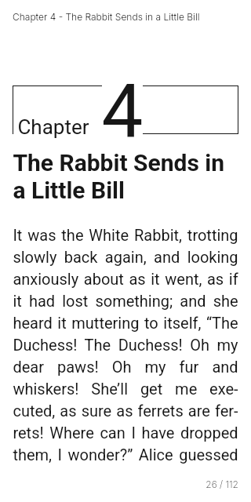

# Phase 7 Android 模拟器验收记录（2026-10-26）

状态：Android API 34 x86_64 模拟器的上游与 Scholar 身份阅读交互子集已限定范围验收；连续复验和 Scholar 阅读器截图见下。历史失败及修复过程保留如下。此范围不代表跨端同步或真机验收。

| 项目 | 环境与结果 |
|---|---|
| 构建与运行 | GitHub Actions `ubuntu-latest`，Android API 34 / Google APIs / x86_64 模拟器、KVM，调试 APK `com.bilingify.readest` |
| 首次成功 | [run 40277087713](https://github.com/gkwfhv/readest-scholar/actions/runs/40277087713)：5 套件、18/18 通过；但随后重复运行失败，故此时未验收 |
| 失败复现 | [run 40278828669](https://github.com/gkwfhv/readest-scholar/actions/runs/40278828669) 与后续诊断运行中，首个 `top-band-selection` 套件在打开测试 EPUB 后停留于 `/library?reload=...`；其余 16 项通过 |
| 根因 | Android VIEW Intent 已到达、排队并回放到 JS。带 `reload` 参数的第二次书库初始化与第一次并行处理同一文件，在 Turso 迁移表上发生 `UNIQUE constraint failed: __migrations.name (19)`；两次初始化交错还令书库路由的打开文件门控状态滞留 |
| 修复 | [`eacd501`](https://github.com/gkwfhv/readest-scholar/commit/eacd501800400c4f74acd41486f5d9a771a22ef9) 对书库初始化串行化，已卸载或离开书库的排队任务不再执行，文件保存完成后才允许下一次初始化；失败时保留 Intent/CDP 诊断。临时产品级跟踪已在 [`e19007e`](https://github.com/gkwfhv/readest-scholar/commit/e19007ef02399f94d5865bb54bf09c05de5f6a91) 移除 |
| 修复后复验 | [run 40288180613](https://github.com/gkwfhv/readest-scholar/actions/runs/40288180613)：5 套件、18/18 通过，0 跳过；[最终干净提交 run 40290109568](https://github.com/gkwfhv/readest-scholar/actions/runs/40290109568)：5 套件、18/18 通过，0 跳过，`top-band-selection` 32.8 秒，全程 139 秒 |
| 服务器静态检查 | Docker 构建容器内 Biome 与应用 TypeScript `--noEmit` 通过；未将服务器工作树中无关子模块状态纳入提交 |

已覆盖 EPUB 选区、系统选择菜单、页眉触控目标和双击标注入口。未覆盖 Android 真机、PDF、同步、离线、系统后台限制；这些能力保持 experimental，并在正式稳定发布前逐项补齐真实环境证据。

## 后续稳定性回归

文档提交 [run 40292512008](https://github.com/gkwfhv/readest-scholar/actions/runs/40292512008) 的首次运行与同提交重跑均在第二个 `selection.android.test.ts` 的准备阶段失败：第一个套件和其余三个套件通过，合计 11 项通过、7 项跳过。重跑的 VIEW Intent 已送达，但 90 秒内仍只见首页 CDP 页面，`adb shell pidof com.bilingify.readest` 返回进程不存在；模拟器同时报告 ColorBuffer 错误。首次运行仅报告 120 秒 hook 超时。当前证据不足以区分应用崩溃、系统回收和模拟器图形故障。已在测试辅助代码中增加崩溃日志与进程退出信息采集，下一轮以这些证据定位；此前两次通过不作为稳定性验收。

诊断提交 [run 40297586723](https://github.com/gkwfhv/readest-scholar/actions/runs/40297586723) 又一次 18/18 通过，第二套件 32.1 秒；它没有复现进程退出。因此已调整夹具：`am force-stop` 后先确认旧 PID 消失，再等待模拟器释放 WebView/图形资源；下一次连续 CI 复验仍为稳定性判据，而不是把这次成功视为根因确认。

## 夹具进程清理后连续复验

[提交 `445a034`](https://github.com/gkwfhv/readest-scholar/commit/445a0342ec37b9a6a8abf25201296892b052e1b3) 在 `am force-stop` 后等待旧 PID 消失，并留出 3 秒释放 WebView/图形资源，然后再启动下一份 EPUB。它针对连续套件间进程退出的时序风险；历史失败未稳定复现，故不能宣称已证明唯一根因。

[run 40299624507](https://github.com/gkwfhv/readest-scholar/actions/runs/40299624507) 首次 job `121494023265` 和同 job 重跑 `121499803625` 均为 5 套件、18/18 通过，0 跳过、0 测试重试；先前易失败的第二套件分别用时 34.6 秒与 30.5 秒。两次使用同一代码提交和同一 GitHub runner 类型。由此接受 **API 34 x86_64 模拟器 EPUB 阅读交互** 的限定范围自验收；这两次成功不能证明长时稳定或真实设备行为。

## Readest Scholar 身份包（模拟器）

[Scholar Android E2E run 40290855604](https://github.com/gkwfhv/readest-scholar/actions/runs/40290855604) 在同一 API 34 x86_64 模拟器中构建并安装 Scholar 调试 APK。ADB 列包明确返回 `package:io.github.gkwfhv.readestscholar`。5 个套件、18/18 项最终通过，0 跳过，运行 133.98 秒；第二个 `top-band-selection` 用例曾重试一次后通过，说明这一触控用例仍可能受模拟器时序影响，需继续观察。随后 [run 40293065661](https://github.com/gkwfhv/readest-scholar/actions/runs/40293065661) 在第二个阅读套件失败，App 进程消失；故此结果仅证明曾成功构建、安装和运行，不能据此验收稳定性，也不扩展为真机、跨端同步或发行签名结论。

## Scholar 阅读器视觉复验

[run 40301256972](https://github.com/gkwfhv/readest-scholar/actions/runs/40301256972) 的首次 job `121499423040` 与同 job 重跑 `121507155304` 在 Scholar 包 ID `io.github.gkwfhv.readestscholar` 上均为 5 套件、18/18 通过，0 跳过、0 测试重试。[run 40311571914](https://github.com/gkwfhv/readest-scholar/actions/runs/40311571914) 增加从已渲染阅读器内采样的屏幕截图后再次 18/18 通过。首次截图运行 [40308748159](https://github.com/gkwfhv/readest-scholar/actions/runs/40308748159) 拍到了测试结束后的 Android 主屏，故没有用于界面验收。

截图为 320×640 API 34 模拟器、英文 EPUB 第四章页面；页眉、章节标题、正文及底部页码均可见，未见裁剪或重叠。PNG SHA-256：`af2d96bf09b1cdc2b1cfd4b396cf31aeb47076bc14437fe8931b5e484c193b4e`；[原始 CI 工件](https://github.com/gkwfhv/readest-scholar/actions/runs/40311571914/artifacts/12646440737) 摘要 `sha256:6f6e51c6265a24bc15a713941309cce1227b75a9e623de5e68acfef42e565bd9`。Android 书库页、PDF、同步、后台限制和真实设备仍未验收。

## Scholar 冷启动书库验收

此前品牌包的阅读器截图正常，但冷启动书库页在 CI 截图中为空。CDP 诊断证实 WebView 已加载根路由 `/`，而书库初始化队列仅允许 `/library`，导致根路由没有执行 `initLibrary()`。[修复提交 `6a87294`](https://github.com/gkwfhv/readest-scholar/commit/6a872948a81520f84dc4f2dbc91507d9449bd7dc) 允许根路由初始化书库。另将模拟器从偶发 Google Play 服务崩溃的 Google APIs 镜像切换到 API 34 AOSP x86_64；此前一次退出信息为 `DEPENDENCY DIED`，该系统故障与书库路由错误分开处理。

修复后，基线 [run 40325146120](https://github.com/gkwfhv/readest-scholar/actions/runs/40325146120) 和品牌包 [run 40325199271](https://github.com/gkwfhv/readest-scholar/actions/runs/40325199271) 均完成 5 套件、18/18 项 Android 阅读交互测试。品牌包随后冷启动到 `http://tauri.localhost/`，CDP 读取到书库布局宽 320px 与非空文本，ADB 截图显示搜索栏、书架卡片、书名和导入入口。

截图来自 [原始 CI 工件](https://github.com/gkwfhv/readest-scholar/actions/runs/40325199271/artifacts/12651606930)，PNG SHA-256：`7e19ea51324f1f01aaaf2b46e2bb828f28ea5a8994936ba73a04c4a2eb1266c0`。这是 API 34 模拟器的 320×640 调试包画面；书籍封面在此截图中为占位白卡，标题与控制栏可见。Android 真机、系统后台行为、PDF 与跨端同步仍需独立验收，不能由本截图推出。
