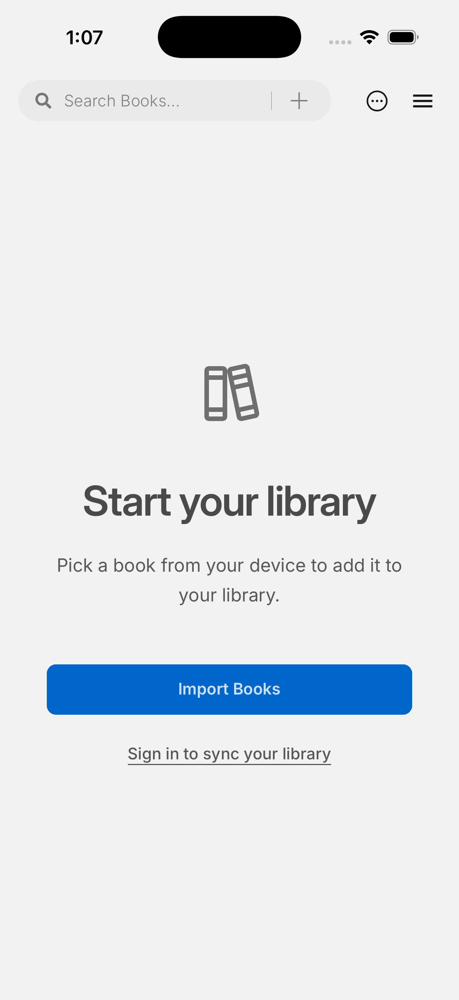

# Phase 7: Scholar iOS 模拟器身份与首屏

2026-10-26，[GitHub Actions run 40286916381](https://github.com/gkwfhv/readest-scholar/actions/runs/40286916381) 在 `macos-15`、Xcode 16.4、`aarch64-apple-ios-sim` 构建无签名 Readest Scholar App，并验证主应用 Bundle ID 为 `io.github.gkwfhv.readestscholar`。准备脚本同时将分享扩展、小组件和 App Group 从上游 ID 改为 Scholar ID。运行提交为 `14f1092bcf11da300025029a4184ffc1a7ab12e5`。

模拟器安装和启动成功；启动后约 15 秒及 60 秒的截图均显示完整空书库页面。两张截图的内容区域各有 9 种采样颜色；此前 [run 40283386975](https://github.com/gkwfhv/readest-scholar/actions/runs/40283386975) 在较早取样时曾得到单色空屏，因此首轮成功状态不能当作 UI 验收。后续 CI 加入自动空屏门槛。

App ZIP SHA-256 为 `d5bfa54422cc2697e5ea67d7e003b0c9b6009399284166adb561d1249baee536`；[CI 工件](https://github.com/gkwfhv/readest-scholar/actions/runs/40286916381/artifacts/12636300370)含两张截图、启动日志和安装包。此次覆盖身份、编译、安装、启动和首屏布局；未覆盖文件导入、触控、Apple Pencil、后台、离线同步、正式签名或真机。iOS 保持 experimental。

最终自动门槛复验：[run 40290699256](https://github.com/gkwfhv/readest-scholar/actions/runs/40290699256) 在提交 `d85d70cc9ad0800654458e5f142cdfdbcc25e6a1` 成功。构建脚本核对主 App Bundle ID，模拟器启动进程 `io.github.gkwfhv.readestscholar`，延迟截图的内容区域采样到 9 种颜色，通过新增的非空白检查。该次 App ZIP SHA-256：`79fb858d222e7d8bd42d930c29224ba872cbc42501d5077759ce3d0dd1056451`；[工件](https://github.com/gkwfhv/readest-scholar/actions/runs/40290699256/artifacts/12637186985)摘要 `sha256:fd97a8ac2f5c46487e13d2cfa122bf2d35642967338b1eea0a3298f52c8eea34`。此结果仍只验收模拟器身份、启动与首屏，真实设备和其他移动能力维持 experimental。

## 最终身份元数据与首屏复验

[run 40323775458](https://github.com/gkwfhv/readest-scholar/actions/runs/40323775458) 在提交 `c0811d5b87a20a74229187430e11b87dea8b0737` 完成无签名 `arm64` iOS 模拟器构建、元数据检查、安装、启动和非空白首屏检查。服务器下载 [原始 CI 工件](https://github.com/gkwfhv/readest-scholar/actions/runs/40323775458/artifacts/12652480811) 后直接检查编译产物的 Info.plist：主 App `CFBundleName=Readest Scholar`，Bundle ID `io.github.gkwfhv.readestscholar`，URL scheme 只有 `readest-scholar`，iCloud 容器为 `iCloud.io.github.gkwfhv.readestscholar`；分享扩展与小组件 ID 分别为 `io.github.gkwfhv.readestscholar.ShareExtension` 和 `io.github.gkwfhv.readestscholar.ReadestWidget`，显示名均为 Readest Scholar。主 App 与两个扩展的短版本号、构建号均为 `0.12.16`；Face ID 文案使用 Readest Scholar 名称。

最终截图为 1206×2622；搜索、导入、菜单、空书库说明、登录入口与安全区域均可见，无明显裁剪或重叠。截图 SHA-256：`a81481efb19a4c4b4dc1067a9ecbd4ef66b4bfe0ee053e64cd05e27d1b69a970`；嵌套 App ZIP SHA-256：`68375f6b39194bff1fb151bd0cb8f9183f928b10f2031fb86710964207651a90`。上游 iCloud、OAuth URL scheme 及扩展显示名残留在较早构建中，已由本次编译产物复核排除。当前验收范围仍限模拟器安装、启动、空书库首屏和身份；真机、导入、阅读交互、同步及正式签名均未验收，iOS 保持 experimental。
