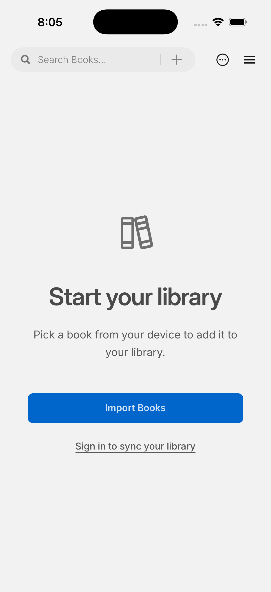

# Phase 7: Scholar iOS 模拟器身份与首屏

2026-10-26，[GitHub Actions run 40286916381](https://github.com/gkwfhv/readest-scholar/actions/runs/40286916381) 在 `macos-15`、Xcode 16.4、`aarch64-apple-ios-sim` 构建无签名 Readest Scholar App，并验证主应用 Bundle ID 为 `io.github.gkwfhv.readestscholar`。准备脚本同时将分享扩展、小组件和 App Group 从上游 ID 改为 Scholar ID。运行提交为 `14f1092bcf11da300025029a4184ffc1a7ab12e5`。

模拟器安装和启动成功；启动后约 15 秒及 60 秒的截图均显示完整空书库页面。两张截图的内容区域各有 9 种采样颜色；此前 [run 40283386975](https://github.com/gkwfhv/readest-scholar/actions/runs/40283386975) 在较早取样时曾得到单色空屏，因此首轮成功状态不能当作 UI 验收。后续 CI 加入自动空屏门槛。

App ZIP SHA-256 为 `d5bfa54422cc2697e5ea67d7e003b0c9b6009399284166adb561d1249baee536`；[CI 工件](https://github.com/gkwfhv/readest-scholar/actions/runs/40286916381/artifacts/12636300370)含两张截图、启动日志和安装包。此次覆盖身份、编译、安装、启动和首屏布局；未覆盖文件导入、触控、Apple Pencil、后台、离线同步、正式签名或真机。iOS 保持 experimental。
