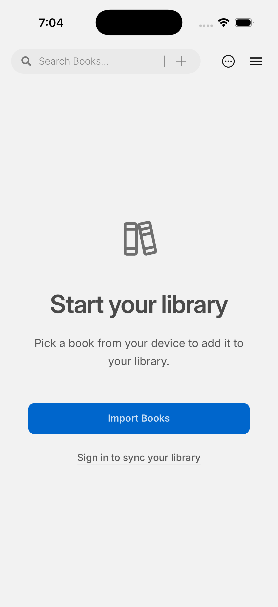

# Phase 7: iOS 模拟器基线

2026-10-26，[GitHub Actions run 40281300606](https://github.com/gkwfhv/readest-scholar/actions/runs/40281300606) 在 `macos-15`、Xcode 16.4、`aarch64-apple-ios-sim` 上成功构建无签名 iOS App，启动一个可用 iPhone 模拟器，安装并启动应用，生成截图和 App ZIP 工件。运行对应提交 `c69d925dd2dd436604769f2b0aeed8ca16b95ed6`。

截图显示空书库页面已渲染：顶部搜索与导入入口、安全区、空状态图标及导入按钮均可见，没有遮挡或溢出。工件内 App ZIP 的 SHA-256 为 `542450e5ee059a13846eac6cf2300c589a2689d3b93cc90b432fdfe01af620ea`；[CI 工件](https://github.com/gkwfhv/readest-scholar/actions/runs/40281300606/artifacts/12633302655)的压缩包摘要为 `52e4cee55f734eeeb986da4172ddb9992260a4c2291c3fce14ac74704a37f1d7`。

此基线仍使用上游 Bundle ID `com.bilingify.readest`。Scholar 独立身份的模拟器验证在 PR #59；本次只覆盖启动和首屏，尚未覆盖文件导入、触控、Pencil、后台/离线同步或真机。iOS 状态仍为 experimental。
